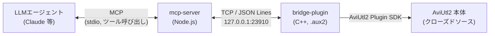
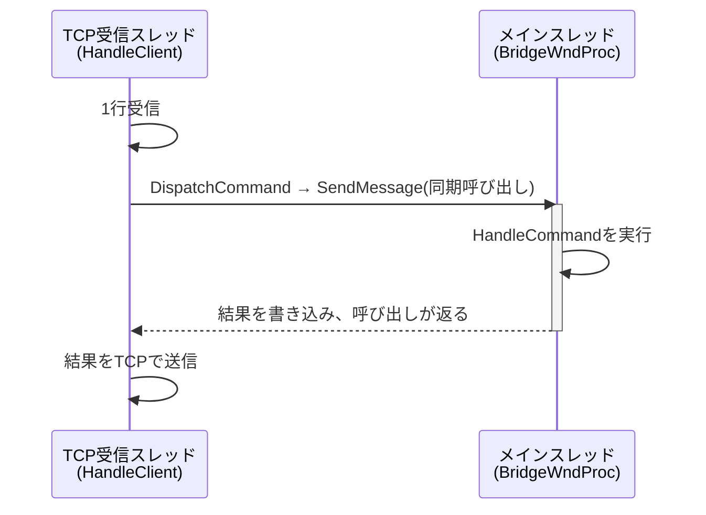

# アーキテクチャ

本書は、本プロジェクトの全体構成および設計意図を示すものである。

- 実現すべき機能 → [REQUIREMENTS.md](REQUIREMENTS.md)
- 実装順序の方針 → [DESIGN_POLICY.md](DESIGN_POLICY.md)
- SDKの使用方法・既知の不具合事例 → [SDK_NOTES.md](SDK_NOTES.md)

本書はこれらを前提として、「現在のシステムがどのような構成であり、なぜその構成を採用したか」に限定して記述する。

## 1. 全体構成: 3層アーキテクチャ



各層は異なる理由により必要とされている。

| 層 | 役割 | 必要性 |
|---|---|---|
| **mcp-server** | LLMエージェントに対してツール群を公開する窓口 | MCPプロトコルを実装するのはこの層のみであり、AviUtl2に関する知識は持たない |
| **bridge-plugin** | AviUtl2内部に常駐し、実際の操作を実行する | AviUtl2を外部から操作する唯一の手段が、プラグインとして内部に常駐することである |
| **AviUtl2本体** | 既存のソフトウェア | 改変は行わない。公式Plugin SDK経由でのみ関与する |

### 2層構成を採用した理由

AviUtl2のプラグインはC++のDLLとして実装する以外の選択肢がない。一方、LLMエージェントとの通信(MCP)はNode.js等で実装するのが標準的であり、これをC++で実装することは合理的でない。
そこで「AviUtl2操作を担う層(C++)」と「LLMとの対話を担う層(Node.js)」を分離し、両者を単純な自作プロトコル(TCP + JSON Lines)で接続することとした。これにより、各層をそれぞれ適した言語で実装し、独立に改修できる構成としている。

**設計意図**: mcp-server側はbridge-pluginの実装言語やAviUtl2 SDKの詳細を一切知らない。bridge-plugin側もMCPのプロトコルを知らない。両者が共有する知識は「`{"cmd": "move_object", ...}`という1行を送信すると、`{"ok": true, "result": {...}}`という1行が返る」という単純な取り決めのみである。いずれかの層を別の実装に置き換えても、もう一方への影響はない。

## 2. bridge-pluginの内部構成

当初は`main.cpp`に全処理を記述していたが、取扱うコマンド数の増加に伴い保守性が低下したため、役割単位でファイルを分割した。

```
main.cpp              プラグイン登録のみ(AviUtl2から呼び出されるエントリポイント)
globals.h/.cpp         共有状態(g_edit, g_logger)およびログ出力
json_types.h           json型の別名定義(重複定義を避けるための共通ヘッダ)
string_utils.h/.cpp    UTF-8/UTF-16変換、Base64エンコード
object_utils.h/.cpp    object_id解決・一覧化等、object_id関連の共通処理
commands_read.h/.cpp        カテゴリA: 読み取り系コマンドの実装
commands_edit.h/.cpp        カテゴリB: 編集系コマンドの実装
commands_rendering.h/.cpp   カテゴリD: レンダリング系コマンドの実装(PNGエンコードを含む)
commands_fileio.h/.cpp      カテゴリF: プロジェクト保存・読み込み系コマンドの実装
bridge_server.h/.cpp   TCP通信およびスレッド間の橋渡し(コマンドの内容には関与しない)
```

### 設計意図: カテゴリ追加時に既存ファイルを変更しない構成

`bridge_server.cpp`内の`HandleCommand`は、コマンド名に応じて該当カテゴリの処理関数へ振り分けるのみである。

```cpp
json HandleCommand(const json& req) {
    ...
    if (TryHandleReadCommand(cmd, req, res)) return res;
    if (TryHandleEditCommand(cmd, req, res)) return res;
    // 該当なしの場合は unknown command
}
```

`TryHandle*Command`は「当該コマンドを処理可能であれば実行してtrueを返し、不可であればfalseを返す」という統一された規約に従う。今後カテゴリD(レンダリング系)を追加する場合は、`commands_rendering.h/.cpp`を新規作成し、`bridge_server.cpp`に`if (TryHandleRenderingCommand(...)) return res;`を1行追加すればよい。既存の`commands_read`/`commands_edit`は変更対象とならない。

この構成の対価はファイル数の増加であるが、[REQUIREMENTS.md](REQUIREMENTS.md)のカテゴリ分類(A〜F)がそのままファイル分割の単位となっているため、機能とファイルの対応関係が常に一対一で把握できる。

## 3. スレッドモデル



AviUtl2 Plugin SDKの編集・参照系API(`call_edit_section_param`等)は、**メインスレッドからの呼び出しを前提**としている。この制約はドキュメント上明示的ではなく、別スレッドから直接呼び出してAviUtl2をクラッシュさせたことにより判明した([SDK_NOTES.md](SDK_NOTES.md)を参照)。

一方、TCP通信の待ち受け処理(`accept`/`recv`)をメインスレッドで実行すると、AviUtl2の画面全体がフリーズする。

このため、以下のように役割を分離している。

- **通信は専用スレッドで実行する**(`ServerLoop`/`HandleClient`): 待ち受け中もAviUtl2は応答可能な状態を維持する
- **AviUtl2の操作は必ずメインスレッドで実行する**(`BridgeWndProc`経由): クラッシュを回避する
- 両者を`SendMessage`(Windowsのスレッド間メッセージング機構。送信側は処理完了まで待機する)で接続する

**設計意図**: この橋渡し部分(`DispatchCommand`/`BridgeWndProc`)はコマンドの内容を一切解釈せず、JSONデータを転送するのみである。スレッド安全性に関する知識をこの1箇所に集約することで、`commands_read.cpp`等の実装者は「自身の関数は必ずメインスレッドから呼び出される」ことを前提にでき、スレッドに関する配慮なしにSDK呼び出しを記述できる。

## 4. object_idによるオブジェクト識別

### 制約

AviUtl2 Plugin SDKでは、オブジェクトを「レイヤー番号とフレーム位置」でのみ検索できる(`find_object(layer, frame)`)。しかしMCPツールの引数として位置を用いる場合、操作のたびに位置が変化するため、呼び出し側(エージェント)が位置を継続的に追跡する必要があり、誤操作の要因となる。

### 設計

すべてのオブジェクト操作は、位置ではなく**`object_id`(SDKの`get_object_id`が返す不変の値)**を主キーとする([DESIGN_POLICY.md](DESIGN_POLICY.md)の方針)。しかしSDKには「IDからオブジェクトを直接取得するAPI」が存在しないため、`ResolveObjectById`(`object_utils.cpp`)が**全レイヤーを走査し、IDが一致するオブジェクトを探索する**方式で実現している(詳細は[00_COMMON.md](design/00_COMMON.md)を参照)。

```cpp
OBJECT_HANDLE ResolveObjectById(EDIT_SECTION* edit, int64_t target_id, int layer_max) {
    for (int layer = 0; layer <= layer_max; ++layer) {
        // 当該レイヤー上のオブジェクトを順に確認し、IDが一致した時点で返す
    }
    return nullptr;
}
```

**設計意図**: 実行性能よりも、エージェントから見たAPIの使いやすさを優先した。プロジェクト規模の拡大に伴い走査コストが問題となる可能性はあるが、現時点では実測の上で問題が確認された場合に最適化を検討する方針とした([DESIGN_POLICY.md](DESIGN_POLICY.md)の「早すぎる最適化を避ける」という考え方に基づく)。

### 派生する制約: `EDIT_SECTION::info`の扱い

`layer_max`(走査範囲の上限)の取得には編集情報が必要だが、SDKの`EDIT_SECTION::info`メンバは読み取り専用コールバック(`call_read_section`系)内では使用不可という制約がある(この制約も実装時のクラッシュにより判明した)。そのため、`layer_max`は**コールバックの外で`get_edit_info`により事前に取得し、値として渡す**手順を全コマンドで統一している。

## 5. エラーハンドリングの方針

- ブリッジの応答は常に`{"ok": bool, "result"?: ..., "error"?: string}`の形式とする
- `object_id`が存在しない、操作が失敗した等の場合は、**プロセスをクラッシュさせず**`{"ok": false, "error": "..."}`を返す
- mcp-server側は`ok === false`をMCPの`isError: true`に変換する(`runBridgeTool`、`mcp-server/src/bridge-client.js`)

**設計意図**: LLMエージェントは、存在しないIDの指定や範囲外の値の指定など、人間の操作者よりも誤りを生じやすい。プロセス全体がクラッシュする失敗モードは復旧コストが高い(AviUtl2の再起動が必要となる)ため、「失敗はエラー文字列として返す」ことを徹底している。

## 6. 設計原則

1. **段階的な拡張**: [REQUIREMENTS.md](REQUIREMENTS.md)のカテゴリ(A〜F)単位で実装し、安全性の高い機能から順に対応範囲を広げる
2. **実装順序**: 読み取り系 → 編集系 → レンダリング系 → 保存系の順に実装する。副作用のない機能を先行させ、データ破壊のリスクを伴う機能(保存系)は最後に、かつ個別に設計した上で着手する([DESIGN_POLICY.md](DESIGN_POLICY.md))
3. **クラッシュより失敗を選択する**: 不確実な事項は推測で実装せず、事前に検証する。不確実な操作はエラーを返すに留め、プロセス自体の安定性を優先する
4. **責務の集約**: スレッド安全性は`bridge_server.cpp`に、object_id解決は`object_utils.cpp`に、というように関心事を単一箇所に集約し、カテゴリ追加時に検討すべき事項を最小化する

## 7. 現状の実装状況

[README.md](../README.md)の「現在使えるMCPツール」、および[DESIGN_POLICY.md](DESIGN_POLICY.md)の「次の一手」を参照のこと。
